<div align="center">

# 🐱🚀 Astro Kitty
### Junior Astronaut Mission Trainer

**Train on Earth. Fly to Mars. Explore a 3D Mars world. Keep a Mars base alive.**<br>
A playful web game for kids aged 7–12, built on real NASA space data.

<a href="https://astro-kitty-mission-trainer.vercel.app"></a>

<a href="https://github.com/RAFI-ULL-BARI/Astro-Kitty-NASA-Space-Apps/actions/workflows/test.yml"></a>


<br><br>

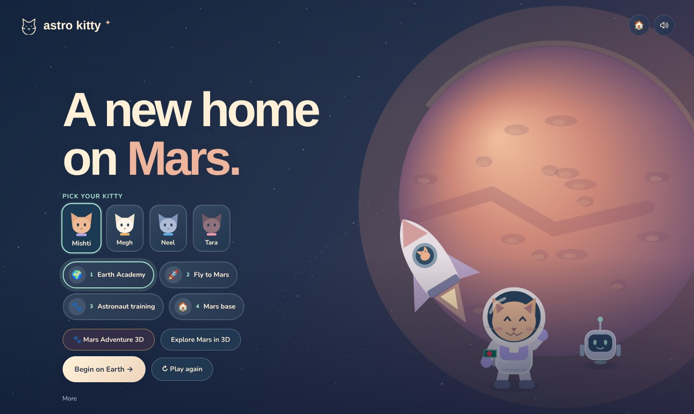

</div>

---

## 🌟 What is Astro Kitty?

Astro Kitty is our answer to the NASA Space Apps Challenge **“Build a Junior Astronaut Mission Trainer.”**

Kids pick a kitty astronaut and, with **Dhrubo** (ধ্রুব, “pole star”), a friendly robot buddy, go from a space center in Khulna, Bangladesh, all the way to a home on Mars.

<table>
<tr>
<td align="center" width="25%"><b>1 · Earth Academy 🌍</b><br><sub>Five hands-on science labs</sub></td>
<td align="center" width="25%"><b>2 · Fly to Mars 🚀</b><br><sub>Plan the trip, then watch it fly</sub></td>
<td align="center" width="25%"><b>3 · Astronaut training 🐾</b><br><sub>Power, shelter, rover</sub></td>
<td align="center" width="25%"><b>4 · Mars base 🏠</b><br><sub>Five Mars days, real choices</sub></td>
</tr>
</table>

Then the whole planet opens up in **3D**, and kids can run their own **Mars Colony**: a big base to explore inside and out, keep alive and grow.

Kids learn by **doing and watching**, not by reading. Every right move earns a cheer: **“Shabbash!”** (Good job!), **“Oshadharon!”** (Amazing!), a happy jump and confetti.

---

## 🪐 Kitty’s Mars Adventure 3D

A walkable 3D Mars world with **24 missions in six chapters**. Kids brush dusty solar panels, drill a rock core, drive a six-wheel rover through crater gates, race a dust storm home, make oxygen, water a space garden and call Earth.

<table>
<tr>
<td width="50%">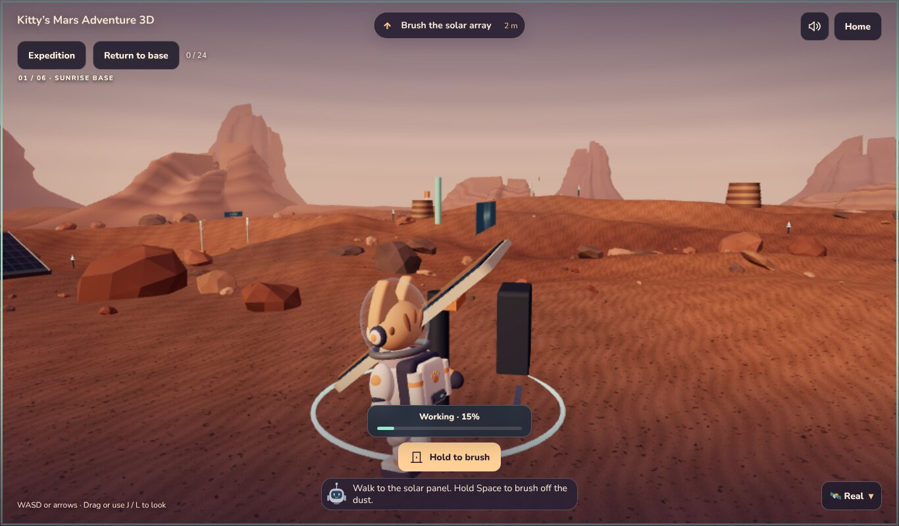</td>
<td width="50%">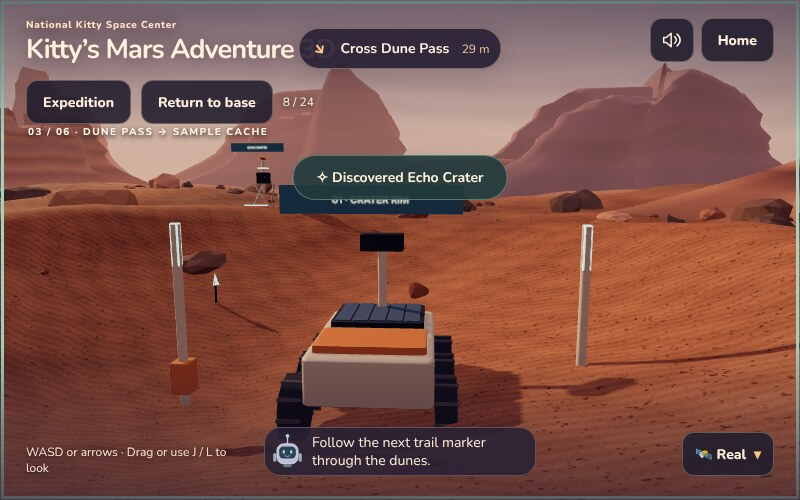</td>
</tr>
<tr>
<td><b>Hands-on tools.</b> Hold to brush, scan, drill and repair. A simple arrow always points to the next job.</td>
<td><b>Drive the rover.</b> Follow the glowing gates across craters and dunes.</td>
</tr>
<tr>
<td width="50%">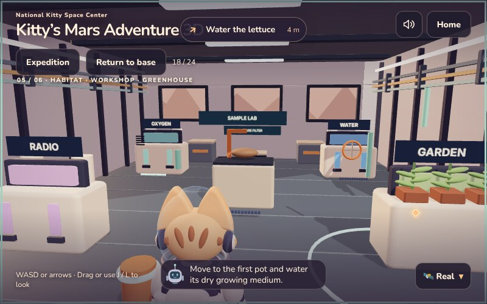</td>
<td width="50%">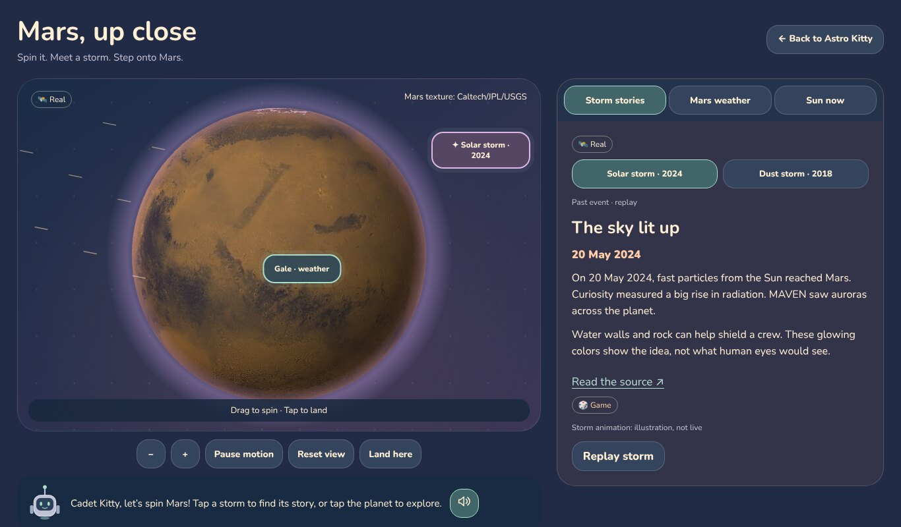</td>
</tr>
<tr>
<td><b>A home on Mars.</b> Fit the air filter, start the oxygen machine, balance the water and grow lunch.</td>
<td><b>Explore Mars in 3D.</b> Spin a real map of Mars, replay real storms and read Curiosity’s weather.</td>
</tr>
</table>

It runs smoothly on phones too: the game lowers its own picture detail when a device is slow, so play stays quick.

The 3D worlds now look real rather than cartoonish, and **the kitty in 3D is the one you picked** on the home screen: Mishti, Megh, Neel or Tara.

<table>
<tr>
<td width="50%">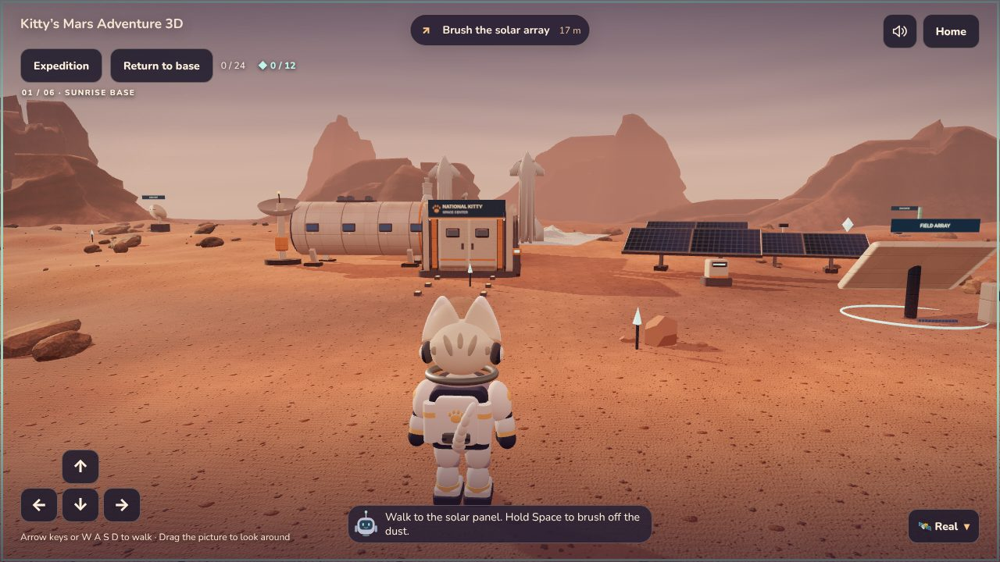</td>
<td width="50%">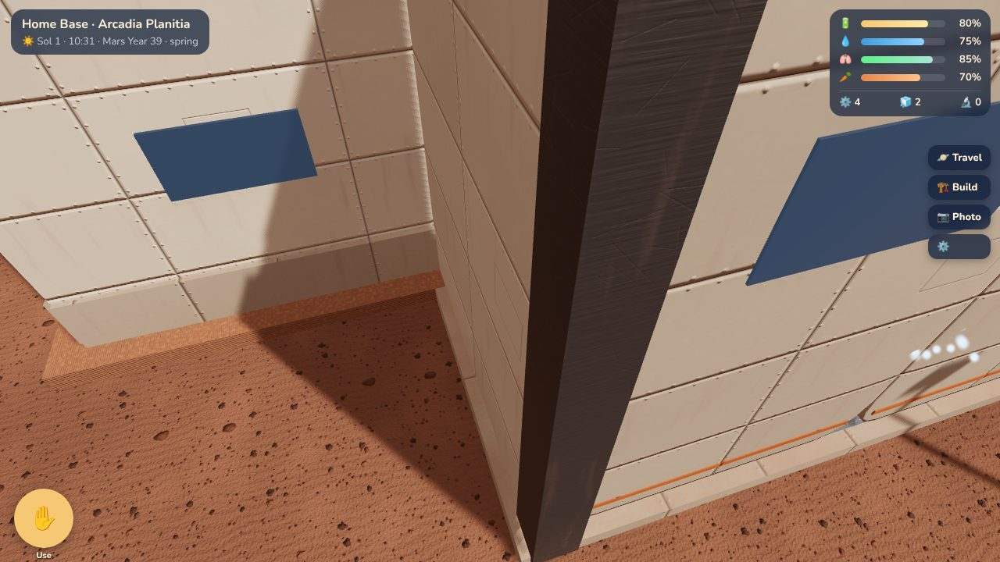</td>
</tr>
<tr>
<td><b>Your own kitty.</b> Megh here, with her orange suit trim.</td>
<td><b>Real surfaces up close.</b> Riveted hull panels, brushed metal, 3D-printed regolith walls and pebbly Mars soil.</td>
</tr>
</table>

- **Real-world surfaces.** Mars soil with grit and pebbles, fractured basalt boulders, hull panels, brushed metal, layered 3D-printed regolith walls, insulation fabric and solar cells. Every texture is made by our own script (`scripts/world/make-textures.py`).
- **Dust on everything.** Red dust settles on the tops of buildings, rocks and rovers and splashes up the bottom of walls, more during dust storms.
- **Light from the sky.** Surfaces are lit by the real colour of the Mars sky around them, metal and visors reflect it, and far hills fade into the dusty haze. On high quality, soft contact shadows, a gentle glow and a touch of film grain finish the picture.
- **Sounds you can hear.** Footsteps crunch on soil and ring on metal floors, airlocks hiss, doors slide, the rover hums, the drone buzzes, the wind blows and the life-support machines whirr.

---

## 🏗️ Mars Colony 3D

A big Mars base to explore **inside and out**, with no loading screens between rooms. Open it from Mission Hub or go straight to `world/colony.html`.

<table>
<tr>
<td width="50%">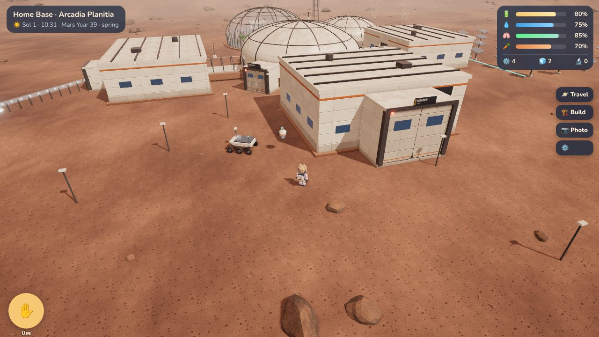</td>
<td width="50%">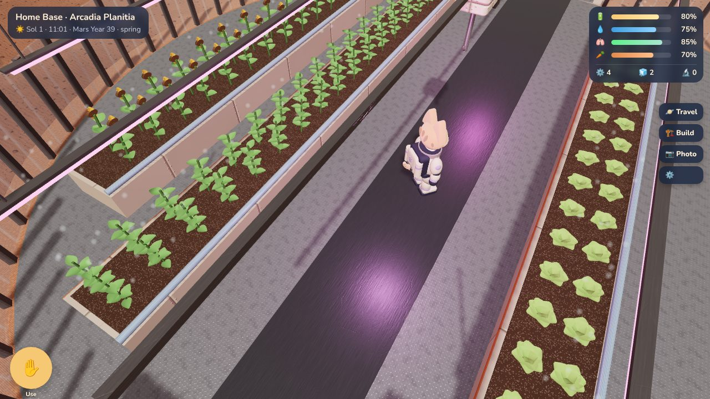</td>
</tr>
<tr>
<td><b>A real base to walk around.</b> A central dome joined by tunnels to a greenhouse, a power plant, a water and oxygen hall, a garage and a science lab, all with realistic hull panels, metal and Mars dust. Step through an airlock and the roof fades away so you can see inside.</td>
<td><b>A plant for food, a plant for power.</b> The greenhouse grows rice, potatoes, lettuce, tomatoes, strawberries and sunflowers. The power plant and the solar farm keep the lights on, and batteries carry the base through the night.</td>
</tr>
</table>

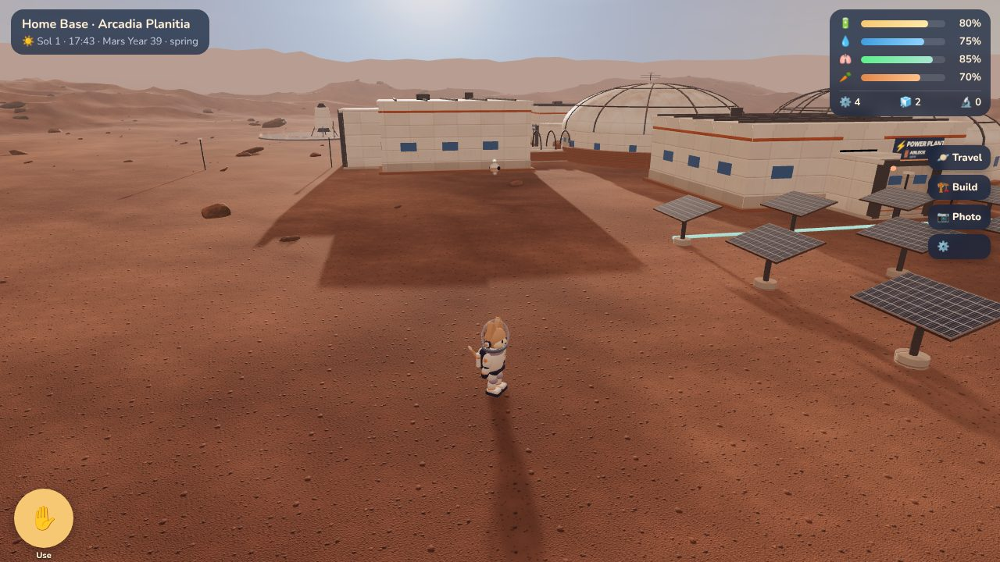

- **Everything moves.** Day turns to night on the real Mars clock (sol, Mars year and season), sunsets glow blue, Phobos and Deimos cross the sky and Earth shines as a small blue star. Dust devils wander, the crew walk about, fans spin and plants sway.
- **Surprises, not a script.** A mission director watches how the base is doing and picks the next problem: a dust storm on the panels, an air leak, mold in the greenhouse, a clogged filter, a jammed ice drill, a power surge, a lost radio link, a cold snap or a stuck rover. Each one has its own mini-game. Some surprises are good news: a supply drop, a dust devil that cleans the panels, a meteorite to study. A solar storm names a real flare from NASA's DONKI records.
- **Keep the base alive.** Power, water, oxygen and food rise and fall as you play.
- **Travel to 9 real places:** Jezero Crater, Gale Crater, Olympus Mons, Valles Marineris, a cave skylight on Arsia Mons, the south pole's ice and geysers, Meridiani Planum, Utopia Planitia, and the moon Phobos. Each one has its own jobs, dangers and a true fact.
- **Build and grow.** Spend metal, ice and science on more solar panels, a reactor, a second greenhouse, an observatory, a playroom, a fuel plant, a 3D printer, a drone and bigger batteries.
- **Drive, fly and take photos.** Drive the rover, fly the drone, unlock new suits (Jamdani pink, Sundarbans green and more) and make postcards.
- **Works on phones.** Touch joystick, keyboard or gamepad. The picture detail adjusts itself to the device, and the colony works offline after the first visit. On low quality the realistic textures are skipped, so slow phones stay smooth.

Controls: move with WASD or the arrows, drag to look, **E** to use, **Space** to jump, **Shift** to run, **M** for the map, **B** to build, **P** for photos.

---

## 🌍 Step 1 · Earth Academy

Five labs at the fictional **National Kitty Space Center** in Khulna: floating, rover testing, growing food, gravity and making air.

<p align="center">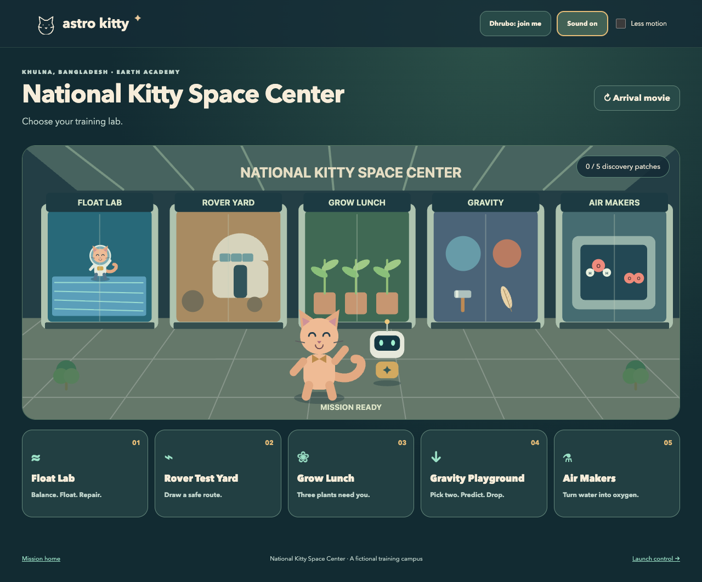</p>

## 🚀 Step 2 · Fly to Mars

Kids plan the trip in four picture choices: **launch day**, **push**, **path** and **landing gear**. Then they watch their own plan fly. Every mistake plays its own animation, so kids *see* why it failed.

<table>
<tr>
<td width="50%"></td>
<td width="50%"></td>
</tr>
</table>

## 🐾 Step 3 · Astronaut training

A walk-and-tap story inside the base: match solar-panel plugs by shape and colour, hide from a solar storm behind a water wall, share two battery cells between the air machine and the radio, and drive the rover.

<p align="center"></p>

## 🏠 Step 4 · Run the Mars base

Choose a **real landing site**, design the base, then keep the crew safe for **five Mars days**. Every day brings a surprise: a leak, a dust devil, a chilly night, or a **real solar storm from NASA’s records**.

<table>
<tr>
<td width="50%"></td>
<td width="50%">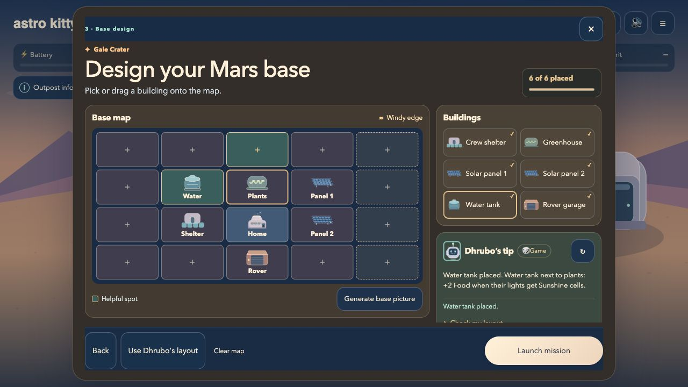</td>
</tr>
</table>

---

## 🛰️ Real NASA data inside the game

| What | How Astro Kitty uses it |
| --- | --- |
| **[NASA Open APIs](https://api.nasa.gov/) + [DONKI space weather](https://ccmc.gsfc.nasa.gov/tools/DONKI/)** | Every solar storm is a **real flare record**. The game fetches recent flares and falls back to a saved archive when offline. |
| **[Curiosity REMS weather](https://mars.nasa.gov/rss/api/?feed=weather&category=msl&feedtype=json)** (NASA/JPL-Caltech/CAB) | The Mars weather card shows dated readings from Gale Crater. |
| **[Viking map of Mars](https://space.jpl.nasa.gov/tmaps/mars.html)** (Caltech/JPL/USGS) | The spinning 3D globe and the landing-site map. |
| **[Mars Trek](https://trek.nasa.gov/mars/)** | Each landing site links to real NASA Mars maps. |
| **NASA mission science** | Short “Real” fact cards: Curiosity’s radiation readings, the May 2024 Mars solar storm, the 2018 dust storm, MOXIE making oxygen, space-station water recycling and more. |

Every fact carries a **🛰️ Real** badge and every made-up game rule carries a **🎲 Game** badge, so kids always know which is which. The 3D landscape and the space center are fictional.

**Also explored from the official Space Apps resources:** [OSDR](https://osdr.nasa.gov/), [RadLab](https://visualization.osdr.nasa.gov/radlab/gui/data-api/), and the Canadian Space Agency’s [STEM resources](https://www.asc-csa.gc.ca/eng/youth-educators/resources-stem-and-youth-organizations.asp) and [food production toolkit](https://www.asc-csa.gc.ca/eng/youth-educators/toolkits/food-production/).

---

## 🧒 Designed for kids

- **Less text, more action.** Short lines, big buttons and animations that show what is happening.
- **A friendly guide.** Dhrubo speaks every line aloud, with captions.
- **Praise in Bangla and English.** Shabbash! Oshadharon! Purr-fect!
- **Four kitties to choose from:** Mishti, Megh, Neel and Tara.
- **Safe to fail.** Wrong answers cost nothing, and the crew is always safe.
- **Sounds for everything.** Every button, link, tab, switch and slider clicks, pop-ups rise and fall, and wins chime with a coin for each star (real sound files from the SoundWeaver library, MIT). Calm background music plays in the story. One button turns all sound off, on every page.
- **Accessible.** Keyboard and touch controls, captions and a reduced-motion mode.
- **Works anywhere.** Phones, tablets and laptops, and offline after the first visit.
- **Teacher page** with ideas for using the game in class.

---

## 🚀 Mission Hub: code, quizzes and crews

Open **Mission Hub** from the home screen's menu (`hub.html`).

| Feature | What kids do |
| --- | --- |
| **🧩 Kitty Code** | Drive a rover with simple code words: `MOVE 2`, `TURN LEFT`, `REPEAT 3 TIMES`, `IF ROCK AHEAD`, `DEFINE HOP`, `WAIT`. It works in Bangla too (`এগোও ২`). 7 worlds and 70 levels, each with 1 to 3 stars: reach the base, write short code, collect every sample. World 7, **Surprise Storm**, adds slippery ice, batteries with charging pads, and dust devils that move every step. |
| **🎲 Remix** | A brand-new level for any world, different every time, so practice never runs out. |
| **🛠️ Level maker** | Paint your own Mars puzzle, beat it, then share a link. Friends have to beat your number of commands. |
| **☀️ Daily Challenge** | One new level every day, the same for every player, with a global leaderboard. Some days bring surprise levels with ice, batteries or dust devils. |
| **❓ Space quizzes** | A 5-question quiz after each part of the story, in English and Bangla. Questions use pictures, true/false and put-in-order. Dhrubo reads every question aloud. A wrong answer gets a short explanation and another try. Every fact has a NASA source. |
| **🏆 Leaderboards** | Three boards: this device, your class (6-letter class code) and the Daily Challenge. Kids appear only by generated kitty names. |
| **🤖 Ask Dhrubo** | Type or speak any space question. Dhrubo answers with Claude when online and from NASA facts when offline. |
| **🔭 Sky tonight** | Where Mars is in your sky right now, the next real launch windows to Mars, when the space station flies over your city, and NASA's picture of the day. |
| **👩‍🚀 Crew mission** | 1 to 4 classmates run a Mars base for 5 sols, each with a job. They chat only with preset messages. A call to Earth waits for the real light-speed delay (sped up). |
| **📔 My Mars Diary** | A printable PDF certificate showing everything the kid learned. |
| **🏫 Class dashboard** | On the teacher page: create a class code and see which topics and questions the class finds hardest. |
| **🤖 Classroom robot** | Run the same Kitty Code on a real micro:bit rover. |

<table>
<tr>
<td width="50%">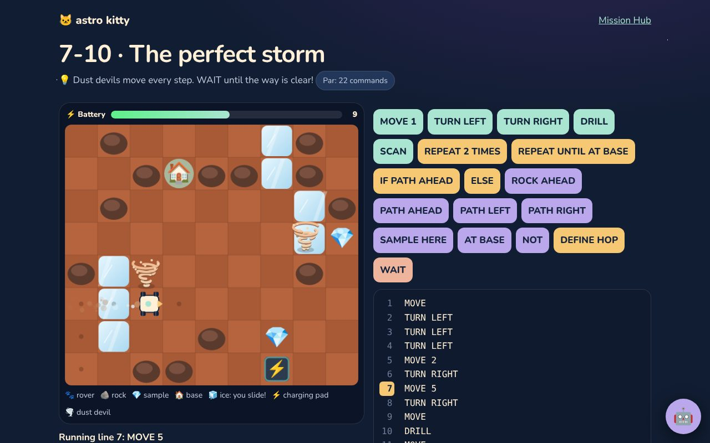</td>
<td width="50%">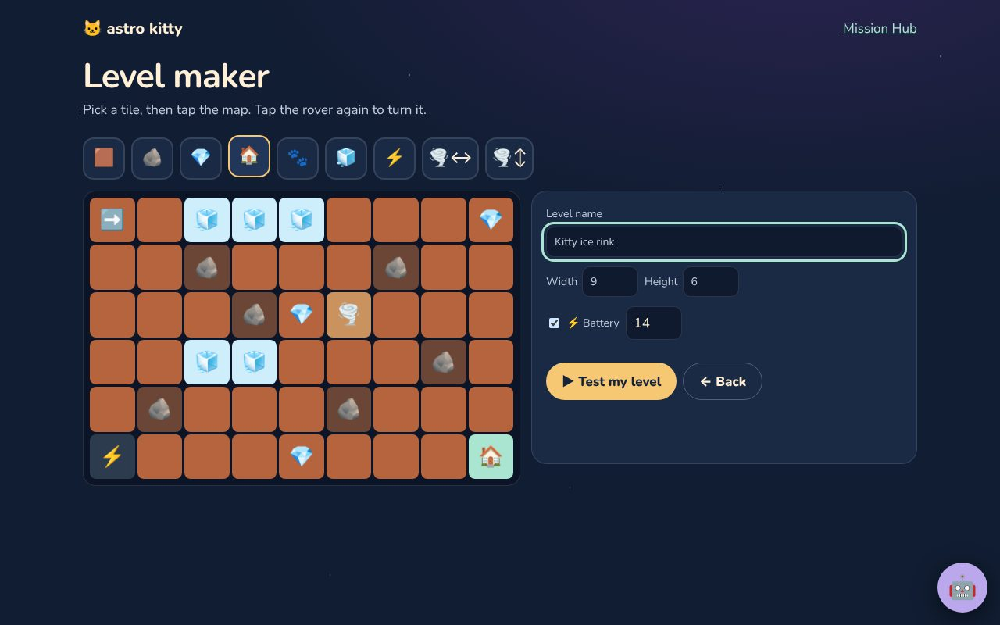</td>
</tr>
<tr>
<td><b>Surprise Storm.</b> Ice, batteries and dust devils that move every step.</td>
<td><b>Level maker.</b> Build a puzzle, beat it, share the link.</td>
</tr>
</table>

Everything above runs on a **Python backend** (FastAPI) in [`backend/`](backend/README.md). It replays every program and quiz answer before a score counts, and it builds all 70 levels (plus every remix) and checks that each one can be won. Without the backend, the game still works offline as before.

---

## 💻 Run it yourself

The game is plain HTML, CSS and JavaScript. The 3D world uses [Three.js](https://threejs.org/).

```bash
git clone https://github.com/RAFI-ULL-BARI/Astro-Kitty-NASA-Space-Apps.git
cd Astro-Kitty-NASA-Space-Apps
python3 -m http.server 8000 --directory dist
# open http://localhost:8000
```

To compile the TypeScript modules, bundle the 3D worlds and run the tests (Node.js 20+):

```bash
npm ci
npm test
```

`npm run build:3d` rebuilds only the two Three.js bundles (`dist/world/colony.js` and `dist/world/mars-surface.js`) from `src/`.

To run everything, including the online features (Python 3.11+):

```bash
cd backend
pip install -r requirements-dev.txt
uvicorn astrokitty.api:app --reload
# open http://localhost:8000
```

```
backend/     Python backend: Kitty Code engine, levels, quizzes, API, AI Dhrubo, robot
dist/        the game itself: hand-written HTML, CSS and JavaScript, served as-is
dist/world/  the 24-mission Mars Adventure 3D and the Mars Colony 3D (bundled)
src/         TypeScript modules that compile into dist/ (flight model, narrator, visuals)
src/colony/  Mars Colony 3D source: base layout, interiors, sky and Mars clock, surprises, places on Mars
scripts/     build and voice helper scripts
test/        automated tests, run on GitHub on every push
voice/       script and tool for Dhrubo's recorded voice
docs/        screenshots and notes
```

More detail: [technical notes](docs/TECHNICAL.md), [Earth Academy](docs/EARTH_ACADEMY.md), [research and design](docs/RESEARCH_AND_DESIGN.md), [release notes](docs/RELEASE_NOTES.md) and [credits](CREDITS.md).

---

## 👩‍🚀 Team Astro Kitty 🇧🇩

**Rafiull Bari** and **Saad Uddin Ahmad Basit**, Bangladesh.<br>
Made with ❤ for the NASA Space Apps Challenge 2026.

---

<sub>NASA does not endorse any non-U.S. Government entity and is not responsible for information contained on non-U.S. Government websites. Astro Kitty is an independent student project and is not affiliated with or endorsed by NASA. The Mars map is © Caltech/JPL/USGS (Viking images, processed at USGS), used for education.</sub>
